# EdgarTools Platform

**Turn captured financial data into consistent identities, traceable facts and
discoverable datasets.** EdgarTools Platform helps people and agents understand
what a source contains, agree how to interpret it, and produce data whose origin
and processing decisions can be explained.

The platform combines **master data management (MDM)**, **reference data
management (RDM)**, source-shaped **silver tables**, and a **Data Catalog**.
Source definitions cover SEC EDGAR, IAPD Form ADV and GLEIF, with captured
OpenFIGI answers supporting security-identifier enrichment. The engine and
workflows are configured through versioned rules. AWS S3 and Snowflake are
the analytics deployment target.

## For executives: what this delivers

| Business need | How the platform addresses it |
| --- | --- |
| Recognize the same entity across sources | Mastering links source records to stable identities under approved identifier and matching rules. |
| Explain which facts to trust | Field selection follows declared source priorities; the winning source and competing evidence remain traceable. |
| Discover and understand available data | The catalog describes sources, fields, quality rules, reference code sets and source-to-master lineage. |
| Add a source with repeatable controls | Skills guide profiling, modeling, mapping, testing and operator approval before activation. |
| Recover interrupted processing | Bookkeeping freezes the work, manages leases and retries, and requires independent read-back verification. |
| Avoid unnecessary reprocessing | Change Journal evidence lets processing skip a file already handled with the same rules and shared inputs. |

**Current scope:** configured reading and mastering run through the
`edgar-warehouse` command and independent workers. Local PostgreSQL 16 is used
for qualification; hosted PostgreSQL is the operational store target. Source
qualification, operator activation and cloud deployment are separate gates.
The configured workers' AWS launch configuration and automated silver pipeline
landing remain integration work. Existing Snowflake/dbt/dashboard assets do
not establish that a new source is deployed end to end.

**Reading paths:** [Sources](#sources-in-the-repository) · [Architecture](#architecture) · [Skills](#how-the-skills-work)
· [Onboard a source](#onboard-a-brand-new-data-source) · [Rules guide](#rules-an-easy-guide)
· [Mastering](#how-mastering-works) · [Data Catalog](#how-the-data-catalog-is-built)
· [Getting started](#getting-started) · [Technical references](#repository-guide)

## Sources in the repository

There are **nine source definitions and 13 Dataset Contracts**. A source folder
describes a feed; a Dataset Contract describes one record type mapped from it.
One provider or captured delivery can therefore support several contracts.

| Source definition | What its rules describe |
| --- | --- |
| [SEC Company submissions](rules/sources/sec.submissions.company/source.yaml) | Company evidence and identity from SEC submissions documents. |
| [SEC Person submissions](rules/sources/sec.submissions.person/source.yaml) | Person evidence from the same submissions family, under separate classification and mapping rules. |
| [GLEIF](rules/sources/gleif/source.yaml) | Legal-entity evidence, accounting-parent relationships and reporting exceptions. |
| [IAPD Form ADV](rules/sources/iapd.adv/source.yaml) | Adviser filings and custodians mapped to Company identities; custody amounts remain separate facts. |
| [SEC ownership, Forms 3/4/5](rules/sources/sec.ownership/source.yaml) | Reporting-owner identities and dated links to issuers. Transaction-table and pipeline work have separate qualification requirements. |
| [SEC 13F information tables](rules/sources/sec.thirteenf.information_table/source.yaml) | Security evidence keyed by CUSIP, keeping the filed issuer name and security title. |
| [SEC N-PORT registrants](rules/sources/sec.nport.registrant/source.yaml) | Filing registrants mapped to Company by CIK, retaining the latest filing's name and address together. |
| [SEC N-PORT securities](rules/sources/sec.nport.security/source.yaml) | Security evidence through separate CUSIP and ISIN-only Dataset Contracts. |
| [SEC N-PORT fund series](rules/sources/sec.nport.fund/source.yaml) | Fund Structure evidence by SEC series ID and eligible LEI, keeping the registrant CIK as a lookup reference. |

N-PORT's registrant, fund series and held security describe different subjects.
They do not become one identity because they appear in the same filing. The
current Fund rules leave the subfund relationship for later evidence of its
start date; they do not infer it from the registrant CIK alone.

[OpenFIGI](rules/sources/openfigi/source.yaml) masters Securities from captured
mapping answers: each answer carries the CUSIP or ISIN asked and every listing's
FIGI, so N-PORT's and 13F's records join the same Security by any of them.

**These are committed definitions, not a list of live services.** Each feed
needs its own captured-file tests, applicable proving run, operator approval,
activation and verified execution. A source file, catalog entry or successful
test does not by itself establish a live deployment.

## Architecture

The platform keeps three kinds of responsibility clear: **Rules describe what
should happen; workers do the work; stores retain and enforce the result.**



The configured processing path starts with captured files. The independent
AWS analytics path shows the deployment target and its existing assets; the
diagram leaves their rollout separate. It does not imply an automatic connection from every
configured worker to Snowflake.
Destinations show responsibilities: RDM publication and silver landing are
explicit workflows, not an automated branch from every reading.

[PNG](docs/diagrams/platform-architecture.png) ·
[Mermaid source](docs/diagrams/platform-architecture.mmd) ·
[Editable Excalidraw](docs/diagrams/platform-architecture.excalidraw)

### Follow one source through the platform

1. **Keep the evidence.** Capture retains the original, hash-verified file as
   a Bronze Artifact. Configured processing can start from files already
   captured; live acquisition has its own qualification and approval.
2. **Understand it.** Profiling identifies parts, record keys, relationships,
   time fields, sensitivity, quality requirements and reference code sets.
   The operator approves the findings.
3. **Describe the processing.** A Source Contract declares how to read the
   file. Its Dataset Contracts map records into MDM; quality and mastering
   policies state checks, matching and field priorities. Operators approve
   exact tested Rules versions and separately authorize activation.
4. **Read and organize.** The configured Rust engine, called through Python,
   extracts rows. Configured combination and reduction can join extracts or
   produce one record per declared key across a complete input set.
5. **Land the appropriate result.** MDM holds identities and relationships;
   RDM holds approved code sets, hierarchies and crosswalks; silver holds
   source-shaped rows with links to MDM where available. A source may need
   several of these destinations.
6. **Verify and expose it.** Workers submit evidence; separate verifiers
   reread destinations before Bookkeeping completes work. MDM publishes
   committed changes to consumers. The Data Catalog exposes metadata, and
   the `context` command exposes bounded answers from the data stores.

### Control and storage

These services sit beside the processing path rather than forming extra
transformation steps. Their PostgreSQL stores have separate ownership and roles.

| Component | Owns |
| --- | --- |
| **Rules** | Versioned contracts and policies, test evidence, approval and activation records. A YAML file alone grants no execution authority. |
| **Bookkeeping** | Frozen work manifests, dependencies, leases, retries, verification and run completion. A worker report alone cannot complete a unit. |
| **Change Journal** | Durable processing and delivery evidence. Application code uses it to decide whether a file needs processing; the journal does not interpret source fields or schedule work. |
| **MDM** | Source evidence, stable identities, bindings, field provenance, relationships, decisions, history and publication intent. |
| **RDM** | Code meanings, published versions, code hierarchies and crosswalks. Readings can pin an exact published version. |
| **Silver** | Registered table specifications and source-shaped rows. Unmastered rows retain their source key and an empty MDM link; links can be refreshed later. |

Bookkeeping answers **“Where did this run stop?”** Change Journal evidence
helps answer **“Has this file already been processed under these inputs?”**
A changed reading or shared input requires processing again; an explicit
`--all` also forces it. This decision is at file/source level, not field level.

### Runtime responsibilities

| Technology | Responsibility |
| --- | --- |
| **Rust** | Generic configured computation. Implemented native paths include reading, projection, coercion, validation, combination, reduction, accepted identity replay and field-ranking kernels. |
| **Python** | CLI, orchestration, integrations, database clients, retries, verification and custom functions. Some matching, relationship and value-materialization work remains Python; the responsibility map distinguishes current owners from proposed ports. |
| **PostgreSQL** | Durable storage, indexed retrieval, constraints, transactions, lease/freshness checks and history. It validates conditions against authoritative shared state before committing. |
| **AWS S3** | Immutable captured objects and warehouse/export objects for the AWS path. |
| **Snowflake + dbt** | Analytics storage and warehouse-wide transformations; Streamlit presents the results. This SQL analytics layer is separate from Snowflake Postgres used for operational MDM. |

The rule is **prepare in code; validate and commit at the destination**.
See the [runtime responsibility map](docs/architecture/runtime-responsibilities.md)
for implementation evidence and qualification boundaries. No separate graph
database is required for MDM's relationship or agent-context reads.

## How the skills work

A **skill is a versioned operating guide for an agent**, with commands,
required evidence, outputs and approval gates. The agent follows the guide;
the CLI and workers execute the processing. Skills make the workflow repeatable
without giving an agent authority to approve its own findings or activate rules.

| Skill | Question it answers | Result or handoff |
| --- | --- | --- |
| [data-platform](skills/data-platform/SKILL.md) | Where do I start, and how do I run the whole flow? | Setup, reading, combining, mastering, recovery and links to specialist skills. |
| [data-operations](skills/data-operations/SKILL.md) | How do agents manage recurring loads as deliveries and capacity change? | Delivery readiness, changed/renamed files, resource sizing, run monitoring, recovery and a maintained operational runbook using Bookkeeping and Change Journal. |
| [data-profiling](skills/data-profiling/SKILL.md) | What is in this delivery, and how do its parts connect? | Human report, machine-readable findings, keys, quality requirements, code sets and silver specifications. Approved findings can produce a public catalog summary. |
| [data-modeling](skills/data-modeling/SKILL.md) | What does each part mean in the model? | Evidence-based decisions about master kinds, identity identifiers, lookup-only references, relationships, code sets and time. |
| [data-onboarding](skills/data-onboarding/SKILL.md) | How do we introduce a new feed or master kind? | Contracts, mappings, quality checks, generated metadata and test evidence, followed by operator approval and activation. Master parts first, then needed reference data, then silver. |
| [data-quality](skills/data-quality/SKILL.md) | Which checks or fixes are needed, and what do they do? | Measured proposals and approved MDM input checks in `quality.yaml`; unresolved cases remain explicit. |
| [refining-rules](skills/refining-rules/SKILL.md) | How do we safely change an existing feed? | Delivery comparison, measured mapping/quality/matching changes, regenerated metadata and a new tested Rules version. |
| [bookkeeping](skills/bookkeeping/SKILL.md) | How do we plan, run, verify and resume processing? | Declared work, worker/verifier execution, progress and recovery. |
| [change-journal](skills/change-journal/SKILL.md) | How do we inspect and recover durable journal delivery? | Verified events and receipts, with recovery coordinated by the producer that owns delivery. |
| [mdm-engineering](skills/mdm-engineering/SKILL.md) | How do we change the MDM engine or schema? | Scoped implementation, migrations and the cheapest proof that establishes correctness. Rules-only onboarding is a different activity. |

For conceptual learning and analysis, the repository also includes
[data engineering fundamentals](skills/data-engineering-fundamentals/SKILL.md)
and [data scientist](skills/data-scientist/SKILL.md) guides.

In practice, a new feed follows **profile → model → map and check → test →
approve → activate → run and verify**. The Mapping Document is a generated
spreadsheet that stewards can review and propose changes to. Those changes
become executable only through a reviewed, tested and approved Rules version.
If configuration cannot express a required operation, a separately reviewed
Python custom step can be added and qualified.

## Onboard a brand new data source

The goal is to turn a captured delivery into **understood records, reviewed
rules and a verified result**. Start with
[data-platform](skills/data-platform/SKILL.md), then follow
[data-onboarding](skills/data-onboarding/SKILL.md) for the detailed procedure.
Use [refining-rules](skills/refining-rules/SKILL.md) when the feed already has
a contract and you are changing it. A second master kind from the same files
gets its own onboarding and source folder.

1. **Prepare the working environment and source evidence.** Follow the
   [setup guide](skills/data-platform/SKILL.md#0-setup), choose the captured
   files and retain their receipts and hashes. Research what the repository
   already knows about the provider, identifiers and delivery format. Get
   permission before making a new provider request, including for documentation.
   Run `edgar-warehouse doctor`; credentials stay in the environment.
2. **Profile the whole delivery and agree what its parts mean.** Identify
   record boundaries, keys, links, dates, sensitive fields and quality defects.
   Reuse approved findings for unchanged inputs. The operator approves the
   findings before mapping decisions proceed. Plan the parts in dependency
   order: master data first, then required reference data, then transaction
   tables and separate relationships in silver. Metadata parts go to Bookkeeping.
3. **Name the feed and define its contracts.** Create
   `rules/sources/<source>/source.yaml`. Declare how to read the capture and
   how each record type maps to a master kind: record key, identity identifiers,
   lookup-only references, fields, relationships and source time. State whether
   the delivery is full or incremental; absence from a later file does not by
   itself retire an identity or close a relationship.
4. **Define quality and mastering decisions.** Add the measured checks and
   fixes in `quality.yaml`. Reuse the destination kind's matching and field
   priorities; adding the feed to them is a merge-policy change requiring review.
   A new kind also needs its own supported model and merge rules. Declare the
   worker steps and verify that every required profile exists. If configuration
   cannot express an operation, record the gap for separate engineering work.
5. **Make the rules readable to stewards.** Generate the source's Mapping
   Document, and the kind's workbook when its rules changed. Reconcile steward
   feedback with the YAML and regenerate the workbook. Preview the Data Catalog
   from the files. From a checkout, after writing the new contract, the commands
   below use an invented source name that you replace with your real folder name:

   ```bash
   edgar-warehouse rules mapdoc write --root rules --only example.register
   edgar-warehouse rules mapdoc check --root rules
   edgar-warehouse rules catalog plan --root rules
   ```

   For an installed bundle, use the writable folder set in `EDGAR_RULES_ROOT`
   instead of `rules`. These commands generate or inspect metadata; they do not
   approve or activate processing. Add the approved profiling summary as
   `profile.yaml` when publishing the part's silver and reference-data metadata.
6. **Test the actual processing path.** Start with a small receipt-verified
   captured sample, then run the qualification the part needs. Check values,
   rejected records, identity decisions, source priority, relationships and
   repeat-run behavior. Matching changes need their proving evidence. The
   installed read → prepare → merge path needs real PostgreSQL 16 proof with
   separate worker and verifier roles; a mapping-only check cannot replace it.
   Reuse the first run's evidence unless inputs, rules or engine changed.
7. **Save, approve and activate as separate steps.** Save descriptively named
   Rules versions, record their test evidence, and inspect `rules pending`.
   Explain the changes and results before asking for the operator's approval;
   record their exact words. Activation needs its own authorization. Activating
   a source also requires receipts from a real acquisition run of that source.
   Follow the [approval guide](skills/data-onboarding/APPROVE.md); merging a PR
   or generating a workbook does not authorize these steps.
8. **Run, verify and expose the result.** Use the declared
   [Bookkeeping workflow](skills/bookkeeping/RUN.md). Workers do the work;
   independent verifiers reread the destinations. Check that all units are
   verified and the run is finalized. Register and land silver explicitly where
   needed. After the metadata PR is merged, publish the reviewed catalog plan
   to the configured catalog server; publication is a separate action.

Keep findings, decisions and evidence in
`.scratch/onboarding/<source>/onboarding-log.md`. Public documentation contains
counts and invented examples; actual records and credentials stay private.
The detailed [contract reference](skills/data-onboarding/REFERENCE.md) is the
authority for syntax and protected identity fields.

## Rules: an easy guide

**Rules are the agreed instructions for interpreting and mastering data.**
They answer different questions; one rule should not silently answer another.

| Question | Where the answer lives | In plain words |
| --- | --- | --- |
| How do we read this file? | The source's `read:` block or accompanying reading YAML | Locate records and extract typed fields from the captured format. |
| What does a row mean? | Dataset Contracts under `mdm:` in `source.yaml` | Name its kind, record key, identifiers, fields, links and time. |
| Is a value usable? | `quality.yaml` | Apply declared fixes, check the result and report what was set aside or withheld. |
| Do records describe the same subject? | `rules/merge/kinds/<kind>.yaml` | Approved matching rules use identity evidence; lookup references alone do not join records. |
| Which source supplies a field? | The kind's `defaults.sources` and `fields.<field>` | Rank eligible claims after identity has been resolved. |
| Is an identifier well formed, and may it decide identity? | `rules/identifiers/` and the kind's Identifier Contracts | Format validation and identity authority are separate requirements. |
| What do codes and links mean? | `rules/reference/`, pinned reference versions and `rules/merge/relationships.yaml` | Give values and relationship types a shared, explicit meaning. |
| What runs, and when is it complete? | The source's `bookkeeping` section or `rules/pipelines/<pipeline>/pipeline.yaml` | Declare worker steps, dependencies, checks and completion requirements. |

### Example: choose a field winner without changing identity

This is an **illustrative fragment**, with invented source codes, from a Company
merge policy. It is not a complete contract or an approval to use those sources.

```yaml
defaults:
  sources:
    - example.register.company.v1
    - example.partner.company.v1
fields:
  address:
    sources:
      - example.partner.company.v1
      - example.register.company.v1
```

After approved matching establishes the identity, the register is preferred
for eligible fields in general; the partner is preferred for the address.
The lower-ranked source can supply an eligible value when the preferred one
has none. Freshness, authorized clearing and other policy conditions still
apply. This priority list does not make two records the same Company.

Quality rules also have distinct outcomes: **`flag`** records a failed check;
**`withhold`** keeps the value but excludes it from matching; **`exception`**
sets the record aside for review instead of merging it. Fixes run before checks
and retain the original value in their evidence. Batch continuation follows the
contract's declared reasons; a rejected record must remain visible in the report.

### Change rules safely

- **Keep identity stable.** Changing a record key, publication key or set of
  identity identifiers requires a new source code. An ordinary mapping or
  quality change needs a new tested version; adding a lookup reference does
  not itself change identity.
- **Measure the effect.** Show which fields, matches, deferrals and winners
  change on pinned captures. A source-order change can alter existing winners;
  a matching-rule change can alter which records share an identity.
- **Keep the written views equal.** Regenerate affected Mapping Documents
  when their rules or generator change. `rules mapdoc check` compares all
  committed workbooks with current rules. The catalog is another published view
  of those files, not a separate place to edit processing behavior.
- **Review before use.** Test the exact version, obtain operator approval,
  and activate only when instructed. Follow
  [refining-rules](skills/refining-rules/SKILL.md) for changes to an existing feed.

For a concrete example, read the
[Company source contract](rules/sources/sec.submissions.company/source.yaml),
its [quality rules](rules/sources/sec.submissions.company/quality.yaml) and
the [Company merge policy](rules/merge/kinds/company.yaml) together. The
[contract reference](skills/data-onboarding/REFERENCE.md) explains the full language.

## How mastering works

**Mastering turns different source descriptions into one stable identity with
explainable fields and relationships.** Reading a file, joining tables and
mastering an identity are different operations.



[PNG](docs/diagrams/mastering-flow.png) ·
[Mermaid source](docs/diagrams/mastering-flow.mmd) ·
[Editable Excalidraw](docs/diagrams/mastering-flow.excalidraw)

### Identity, fields and relationships are separate decisions

| Decision | Meaning | Example, using invented data |
| --- | --- | --- |
| **Source Record Binding** | Assign a source record to the identity it describes. | Two providers report the same approved legal-entity identifier, so their records can bind to one Company under its Identifier Contract. |
| **Identity Consolidation** | Decide that two existing master identities represent the same subject. | A correction proposes combining two published Companies. This needs its own accepted decision; it is not implied by a field priority. |
| **Field Survivorship** | Select an eligible value after identity is resolved. | One source supplies the preferred legal name; another supplies an address where the policy allows it. Losing claims remain evidence. |
| **Relationship projection** | Create a typed link between accepted endpoints for the stated time. | A Company is an accounting subsidiary of another Company. This is different from a reported holding or beneficial ownership. |

For example, suppose two captured sources call a fictitious business “Example
Company A” and “Example Co. A”. An approved shared identifier can establish
that both records describe one Company. A separate field rule then chooses
its displayed name and address. The result retains one master ID, the source
records and why each value won. Without sufficient identity evidence, the
records remain separate even if their names look alike.

An Identifier Contract states which identifiers may decide identity and the
cardinality they must obey. **Cross-references are lookup only:** sharing one
does not join records. A name rule can bind only with measured evidence and
approval of that exact rule. Similar names alone are not a general merge rule.
Ambiguous records stay unbound or go to a steward for review.

### What happens in a batch

1. **Prepare source evidence.** `mdm.prepare` maps a source extract through its
   Dataset Contract. Source Stage keeps the newest reading of each source
   record; bronze retains the earlier captured evidence.
2. **Propose identity decisions.** Approved identifier rules run first;
   approved name rules follow where applicable. The proposal names the
   evidence and pinned policy it relies on.
3. **Check and commit through the Merge Stage.** `mdm.merge` rechecks the
   proposal against current state under the transaction lock. It computes
   affected masters, selects eligible fields and profiles, validates links,
   records decisions and history, advances the checkpoint and enqueues
   publication in one transaction. The destination checks the worker's live
   lease so an expired worker cannot commit.
4. **Publish and verify.** `mdm.publish` delivers a committed batch to a
   consumer in generation order. Changed-record consumers receive inserted
   or changed records; the MDM journal consumer receives the whole batch.
   Independent read-back verifies delivery. `mdm force-publish` can resend
   every current record to a selected consumer for an operator repair.

The Merge Stage is the only writer of master state. It recomputes the affected
identities and the links requiring revalidation, rather than loading every
record in a connected network. A durable batch key makes a retry return the
existing result instead of applying the business effect again. Publication
intent is committed with the master; delivery is subsequently verified and
recoverable, rather than a distributed transaction across all stores.

### The model today

The repository has configured merge rules for **Company, Person, Security and
Fund Structure**. N-PORT adds Company registrants, Security contracts and Fund
Structure series alongside the existing submissions, GLEIF, ADV, ownership and
13F definitions. Adviser and Audit Firm are profiles on Company; a Fund profile
can attach to Company or Fund Structure, according to the subject's model.
Each source still needs its own verified run and activation record.

Branch, Government Entity, International Organization and Market/Venue are
other supported domain boundaries; their presence in the model does not mean
every domain has an active source. A subsidiary and its adviser
remain separate Companies. A rename of the same identity retains its stable
master ID and historical names. Consolidation retains aliases and decisions;
replay needs the accepted identity registry and decision history as well as
source evidence.

## How the Data Catalog is built

The **Data Catalog is the searchable description of the platform's data**.
It helps a business reader ask “What does this field mean and where does it
come from?” and an architect ask “Which contract, source and rule produce it?”
The catalog server is **OpenMetadata**. Metadata is published **one way from
the rules files** into the platform's `edgartools-rules` service.



[PNG](docs/diagrams/data-catalog-flow.png) ·
[Mermaid source](docs/diagrams/data-catalog-flow.mmd) ·
[Editable Excalidraw](docs/diagrams/data-catalog-flow.excalidraw)

| Catalog area | What a reader can discover | Metadata input |
| --- | --- | --- |
| **Sources and datasets** | Feeds, record meaning, source paths, identifier use, mappings and critical data elements. | `source.yaml` and its Dataset Contracts. |
| **Master fields** | Master kinds, their fields, the datasets that fill each field in priority order, and column-level source-to-master lineage. | Source mappings and `rules/merge/kinds/*.yaml`. |
| **Silver** | A table specification per profiled part, every field's logical type, nullability and sensitivity, and the quality rules it needs with failed-row counts from that profiled delivery. | Approved profiling findings summarized in `profile.yaml`. |
| **Reference data** | Code sets the profiled data needs, whether existing or proposed, and lineage to the silver tables that use them. | Code-set metadata in the same approved profile summary. |

### From profiling to discoverable metadata

1. Profiling writes a report and `findings.yaml`. It lists checks even when
   the profiled data passes them, reference code-set needs and silver fields
   for every part, including master-data parts.
2. After approval, profiling's `catalog` mode produces
   `rules/sources/<source>/profile.yaml`. This public summary carries schema
   names, types, classifications and counts; samples and actual source values
   stay outside the public repository.
3. Onboarding or refinement generates the Mapping Document and reconciles
   the reviewed mappings and policies with their Rules files.
4. `edgar-warehouse rules catalog plan` builds the proposed catalog from
   those files without contacting the catalog server. An explicit
   `rules catalog publish` reconciles the platform's OpenMetadata service
   with the plan, including removal of entries the files no longer name.

**What this proves:** the catalog describes the supplied contracts and profile
summaries. It can include draft source contracts and proposed code sets; a
catalog entry is not proof of activation, a physical table load or a current
passing quality check. Silver and RDM profile entries appear only when their
approved summaries are supplied. Cataloged quality requirements do not create
silver enforcement: the current `quality.yaml` execution path checks MDM input
records, and silver has no corresponding generic quality worker yet.

Changing the catalog does not change processing rules. For a specific live
record, use **`edgar-warehouse context`**: it reads master fields and winning
sources, relationship periods, reference meanings or silver table descriptions
from the appropriate store. The catalog answers what data is described;
context answers what the stores currently hold, with provenance and time.
See the [catalog implementation](edgar_warehouse/rules/catalog.py),
[profiling findings contract](docs/specs/profiling/findings.md) and
[agent-context specification](docs/specs/agent-context/spec.md).

## Getting started

For local development before Snowflake, use
[Shared PostgreSQL initialization](docs/local-agent-testing.md). Agents share
one server containing MDM, RDM, Rules, Bookkeeping and the Change Journal.
Initialization excludes silver by default and provisions worker/verifier
access and MDM's lease guard. Separate data copies are for disruptive tests
or recovery; reinitialization preserves existing data.

Before loading retained captures, follow the
[initial and daily source-load sequence](docs/initial-and-daily-source-load.md).
It separates complete source coverage from Change Journal selection and lists
the remaining source-registration and mastering gaps.

Start with the [data-platform setup guide](skills/data-platform/SKILL.md#0-setup)
for the packaged `edgartools-data` CLI, Rust engine, skills and pinned rules.
Python 3.12+, Rust tooling and the appropriate PostgreSQL 16 stores are needed.
Credentials and database addresses are supplied through the environment,
outside Git and chat. The [installation script](infra/scripts/install.sh)
offers an ordered infrastructure/install plan; applying it is an operator action.

Once installed, these commands let you inspect the interface and metadata plan:

```bash
edgar-warehouse --help
edgar-warehouse doctor
edgar-warehouse rules catalog plan --root rules
edgar-warehouse workers describe mdm.prepare
edgar-warehouse workers describe mdm.merge
edgar-warehouse workers describe mdm.publish
```

Run a feed using [Bookkeeping run mode](skills/bookkeeping/RUN.md); resume one
using its [recovery guide](skills/bookkeeping/RECOVERY.md). Check that every
declared worker profile exists before submitting a pipeline. A bounded worker
invocation does not prove the complete run finished: completion requires every
declared unit to be verified and the run finalized.

### Current integration boundaries

| Area | Implementation and remaining boundary |
| --- | --- |
| **Configured source reading** | Rust behind the Python `SourceEngine` facade. XML, JSON, JSON Lines, CSV and Parquet, supported archive/envelope forms, and declared streaming paths; see [READING](skills/data-platform/READING.md). Unsupported formats need a qualified Python custom step. |
| **Current source definitions** | The [source inventory](#sources-in-the-repository) includes submissions, GLEIF, ADV, ownership, 13F and N-PORT registrant/Security/Fund Structure definitions. Qualification differs by feed; a definition is not activation evidence. |
| **Live capture** | `provider.capture` has offline HTTPS JSON qualification. Company still selects `artifact.copy`; live acquisition and continuation integration are separate work. See [configured capture](docs/configured-capture.md). |
| **Silver landing** | Explicit local PostgreSQL registration, landing and MDM-ID refresh commands exist. Automated landing through a declared pipeline still requires a verified worker. |
| **AWS execution** | Passive infrastructure, access control and image publishing assets exist. The retired ECS/Step Functions workload is not the configured workers' launch configuration. |
| **Analytics** | S3 native pull, Snowflake, dbt gold and Streamlit assets are present. Source export integration, deployment and end-to-end verification require their own evidence. |

Terraform separates passive infrastructure from access control. Administrators
provision infrastructure; application rollout uses the deployer principal;
runtime uses service-assumed roles. Passive roots do not create runnable
workloads, schedules, image rollouts or runtime secret values. Publish images
with [publish-warehouse-image.sh](infra/scripts/publish-warehouse-image.sh);
the Snowflake operator wrapper is
[deploy-snowflake-stack.sh](infra/scripts/deploy-snowflake-stack.sh).

## Repository guide

| Location | Purpose |
| --- | --- |
| [CONTEXT.md](CONTEXT.md) | Business vocabulary, identity and relationship meanings. |
| [skills](skills) | Versioned agent workflows and operating guides. |
| [rules](rules) | Source contracts, quality rules, mastering policies and pinned reference data. |
| [Runtime responsibility map](docs/architecture/runtime-responsibilities.md) | Current Rust/Python/database ownership and migration prerequisites. |
| [Combining and reducing extracts](skills/data-platform/COMBINING.md) | Configured joins, collections and complete-set reduction. |
| [crates/source-contract](crates/source-contract) | Generic Rust engine, reached through Python callers. |
| [edgar_warehouse/workers](edgar_warehouse/workers) | External workers and independent destination verifiers. |
| [MDM specifications](docs/specs/mdm/README.md) | Identity, evidence, merge, publication and recovery contracts. |
| [RDM specification](docs/specs/rdm/spec.md) | Code sets, approved versions, hierarchies and crosswalks. |
| [edgar_warehouse/silver_writer](edgar_warehouse/silver_writer) | PostgreSQL silver landing and MDM-ID links. |
| [packages](packages) | Separately owned data bundle, Bookkeeping and Change Journal distributions. |
| [infra/terraform](infra/terraform) | AWS/Snowflake infrastructure and access roots. |
| [infra/snowflake](infra/snowflake) | Native pull, dbt gold and Streamlit assets. |
| [tests](tests) | Unit, architecture, MDM, engine and PostgreSQL acceptance evidence. |

Before contributing, read [AGENTS.md](AGENTS.md). Use a dedicated runtime branch
and worktree, run the checks affected by the change, and open a PR. Older
runbooks may describe retired commands; use the current CLI and skill guides.
