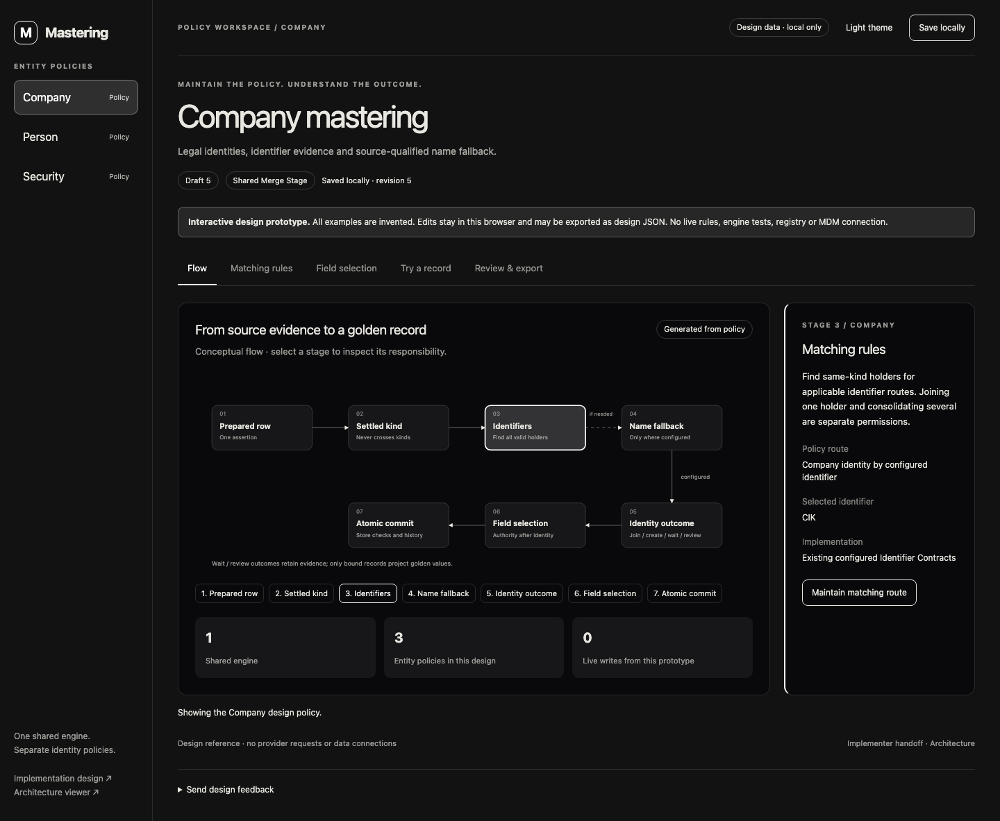

# Mastering console

- [Design](DESIGN.md): what the console shows, what it calls, and what it leaves out.
- [Screen prototype](prototype.html): invented data only; edits and export stay in the browser and change no rule. Its styling uses Tailwind and DaisyUI from a CDN.

Open the HTML file locally; GitHub does not run it. The design is not built and not scheduled.
