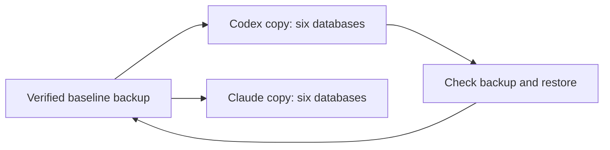

# Local testing with independent data copies

A baseline is a known starting copy of test data. Each agent works on its own
copy. Updating the baseline changes what the next copy starts with; it never
changes another agent's running database.

Use PostgreSQL 16 on the Docker runtime already configured on the machine.
The script uses the existing migration implementations for six databases:
MDM, RDM, silver, Rules, Bookkeeping and Change Journal. It needs the checkout's
Python dependencies, including the `mdm` extra, and the `postgres:16-alpine`
image. It makes no source-provider request and deploys nothing to Snowflake.



## Create your environment

Run from your own git worktree. Pick a name for this workstream, rather than
reusing another agent's name:

```bash
docker pull postgres:16-alpine
uv run --extra mdm python infra/scripts/local-test-stores.py up codex-financials
```

The command reports its name, state and private environment-file location.
Source that file in your terminal to set the six runtime connections. It is
stored outside Git with mode `0600`; do not print it, paste it into chat or
commit it. Schema-owner connections stay separate from runtime connections.
Startup applies the real migrations; repeating startup preserves existing data.

The container listens only on loopback at an automatically assigned port.
Its named volume survives stops and restarts. Resource labels and the private
ownership file bind it to the worktree that created it. A different worktree
must create its own environment; it cannot adopt or stop this one.

## Make and use a baseline

Load the task's permitted captures through its existing source contracts and
workers. A new environment is empty; creating databases is not source onboarding
or proof that financial facts have landed. Keep invented qualification fixtures
distinguishable from captured data, and preserve the original capture receipts.

Once workers have finished, create a checked baseline:

```bash
uv run --extra mdm python infra/scripts/local-test-stores.py backup codex-financials --baseline
```

The script temporarily prevents runtime logins and refuses a backup while other
database connections are still open. It dumps all six databases, checks a restore
into a separate owned environment, and compares table contents. The identity
registry, accepted decisions and silver links travel with the database contents.
If a check fails, the prior baseline remains selected. Successful promotion is
automatic and serialized with a file lock; it needs no approval prompt.

If a backup is interrupted, `up` restores the prior login states before checking
the migrations. Database grants travel with the backup, so restored runtime
connections can use registered silver tables as well as read their metadata.

The restore-check environment is stopped after the check. Its volume is retained,
along with the backup, so this command does not destroy persistent data.

From another worktree, create a new independent copy:

```bash
uv run --extra mdm python infra/scripts/local-test-stores.py copy claude-source-test
```

Omit `--snapshot` to use the latest verified baseline. To restore an older backup,
pass its private directory with `--snapshot`. The target name must be new: copy
never overwrites an existing environment. A failed restore is retained for
diagnosis and cannot be started as if it were a verified copy.

## Stop, restart and recover

```bash
uv run --extra mdm python infra/scripts/local-test-stores.py status codex-financials
uv run --extra mdm python infra/scripts/local-test-stores.py stop codex-financials
uv run --extra mdm python infra/scripts/local-test-stores.py up codex-financials
```

For a backup without changing the baseline, omit `--baseline` from `backup`.
Backups and private connection files live under
`~/.local/share/edgartools/local-tests/`; database storage lives in the named
Docker volumes. A volume survives stopping a container, but does not replace a
backup. Recover to a new environment name and retain the old copy for diagnosis.

There is deliberately no automatic volume deletion or reset command. Use the
existing Docker context; the script does not switch runtimes. On a small Mac,
stop environments when they are not needed. Size affects resource scheduling,
not whether source records are accepted.

## Agent rules and proof

Work proceeds without intermediate approval within the assigned local task.
Keep code in separate worktrees, run the overlap guard before commits and pushes,
and stop for an actual overlap or an unclear scope change. The shared operational
policy is maintained in the data-platform skill.

Acceptance tests continue to use disposable PostgreSQL targets. Do not point
`PG16_ADMIN_URL` at these permanent stores: some existing fixtures intentionally
drop their own schemas or template databases.

The affected integration test uses invented Company records through the Merge
Stage, RDM data and a silver row whose MDM ID is looked up from the master. It
checks six restricted runtimes, independent owners, restart persistence, exact
integer storage, refusal with active connections and full backup/restore equality.
This local proof does not qualify a hosted PostgreSQL or Snowflake deployment.
