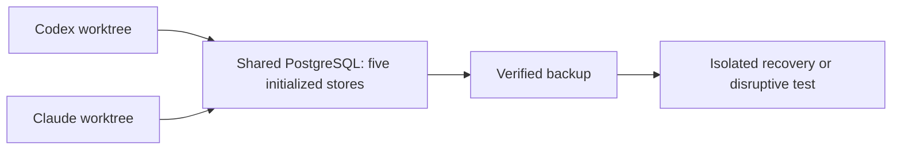

# Initialize shared local PostgreSQL

Agents use one permanent PostgreSQL server and the same MDM identities.
Separate Git worktrees isolate code. A separate data copy is for disruptive
tests or recovery, rather than routine lookups.

Use PostgreSQL 16 on the Docker runtime already configured on the machine.
The script uses the existing migrations for five databases by default:
MDM, RDM, Rules, Bookkeeping and Change Journal. Silver is excluded. It needs the checkout's
Python dependencies, including the `mdm` extra, and the `postgres:16-alpine`
image. It makes no source-provider request and deploys nothing to Snowflake.



## Initialize or reinitialize

Run lifecycle commands from the worktree that created the shared environment.
The current `codex-local-lab` owner is
`edgartools-platform-local-agent-stores-architecture-20261016`. Use the updated
script from a checkout containing this change; code changes belong on a fresh
branch, rather than editing that older merged branch. A script at an absolute
path can run with the owner worktree as its current directory.

```bash
docker pull postgres:16-alpine
uv run --extra mdm python infra/scripts/local-test-stores.py up codex-local-lab
```

The command reports its name, state and private environment-file location.
Source that file in your terminal to set runtime and migration connections. It is
stored outside Git with mode `0600`; do not print it, paste it into chat or
commit it. Schema-owner connections stay separate from runtime connections.
Startup applies the real migrations; repeating startup preserves existing data.
It creates separate Bookkeeping worker and verifier logins, grants opposite
duties for every registered profile, creates a read-only MDM verifier and a
narrow MDM registration login, and installs MDM's Bookkeeping lease guard.
The Rules governance login can record existing approvals and register approved
versions; provisioning does not approve or activate any source or rule.

Four private files are written in the environment folder:

| File | Use |
| --- | --- |
| `connection.env` | Runtime connections plus migration connections for administration |
| `worker.env` | Five runtime connections; Bookkeeping worker and MDM application logins |
| `verifier.env` | Separate Bookkeeping verifier and read-only MDM logins |
| `governance.env` | Rules governance and MDM registration connections |

Source `worker.env` before work and `verifier.env` before verification. These
files clear owner/activation settings left by another duty and omit silver.
`BOOKKEEPING_MANIFEST_ROOT` points to private local files. Connections and
passwords are never printed by initialization.

For an isolated test that explicitly needs silver, add `--include-silver` to
`up`. A default rerun never initializes or migrates silver. An existing silver
database stays intact. Older six-store environments remain six-store backup
sets, even when reinitialized without silver; new environments default to five.

The container listens only on loopback at an automatically assigned port.
Its named volume survives stops and restarts. Resource labels and the private
ownership file bind it to the creating worktree. Other worktrees may use the
private client connections; lifecycle ownership is retained. Coordinate shared
maintenance and do not stop the server while others use it.

## Make and use a baseline

Load the task's permitted captures through its existing source contracts and
workers. A new environment is empty; creating databases is not source onboarding
or proof that financial facts have landed. Keep invented qualification fixtures
distinguishable from captured data, and preserve the original capture receipts.

Once workers have finished, create a checked baseline:

```bash
uv run --extra mdm python infra/scripts/local-test-stores.py backup codex-local-lab --baseline
```

The script temporarily prevents runtime logins and refuses a backup while other
database connections are still open. It dumps the environment's five or six databases, checks a restore
into a separate owned environment, and compares table contents. The identity
registry, accepted decisions and silver links travel with the database contents.
If a check fails, the prior baseline remains selected. Successful promotion is
automatic and serialized with a file lock; it needs no approval prompt.

If a backup is interrupted, `up` restores the prior login states before checking
the migrations. Database grants travel with the backup, so restored runtime
connections can use registered silver tables as well as read their metadata.

The restore-check environment is stopped after the check. Its volume is retained,
along with the backup, so this command does not destroy persistent data.

For an explicitly isolated test or recovery, create a new copy:

```bash
uv run --extra mdm python infra/scripts/local-test-stores.py copy claude-source-test
```

Omit `--snapshot` to use the latest verified baseline. To restore an older backup,
pass its private directory with `--snapshot`. The target name must be new: copy
never overwrites an existing environment. A failed restore is retained for
diagnosis and cannot be started as if it were a verified copy.

## Stop, restart and recover

```bash
uv run --extra mdm python infra/scripts/local-test-stores.py status codex-local-lab
uv run --extra mdm python infra/scripts/local-test-stores.py stop codex-local-lab
uv run --extra mdm python infra/scripts/local-test-stores.py up codex-local-lab
```

For a backup without changing the baseline, omit `--baseline` from `backup`.
Backups and private connection files live under
`~/.local/share/edgartools/local-tests/`; database storage lives in the named
Docker volumes. A volume survives stopping a container, but does not replace a
backup. Recover to a new environment name and retain the old copy for diagnosis.

There is deliberately no automatic volume deletion or reset command. Use the
existing Docker context; the script does not switch runtimes. On a small Mac,
stop environments when they are not needed. Size affects resource scheduling,
not whether source records are accepted.

## Agent rules and proof

Work proceeds without intermediate approval within the assigned local task.
Keep code in separate worktrees, run the overlap guard before commits and pushes,
and stop for an actual overlap or an unclear scope change. The shared operational
policy is maintained in the data-platform skill.

Acceptance tests continue to use disposable PostgreSQL targets. Do not point
`PG16_ADMIN_URL` at these permanent stores: some existing fixtures intentionally
drop their own schemas or template databases.

The affected integration tests check real five-store startup, separate worker
and verifier processes, Rules governance handoff, MDM lease refusal, data
persistence and five-store backup/restore. The optional six-store test uses
invented Company records, RDM data and a silver row with a looked-up MDM ID and
an exact BIGINT; core-only reinitialization preserves those older silver rows.
This local proof does not qualify a hosted PostgreSQL or Snowflake deployment.
