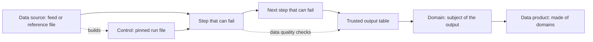

# Lineage

A steward follows one path: a data source, the steps that can fail with their
data quality checks, the trusted outputs, then the domain and the data
product the domain belongs to. Publish native edges for that path. Keep the
mapping document in the rules repository.

## What is on the path

1. Data source. One per configured source. It starts the path: each feed the
   target reads, and each named reference file that no feed captures. A file
   the same target wrote on the way is not a source.
2. Control. A pinned run file a step reads is drawn once. Its inbounds are the
   feeds its contract requires, including another source when the contract
   names that source. An unread run file is not a control.
3. Steps that can fail. Capture, combine, prepare, merge, land, derive, and the
   step that reads a pinned run file. Each is its own Pipeline named
   `source:<source>:<target>:<step>` whose description lists the checks it
   declares. A read-only plumbing step, and the step that records processed
   files, are not drawn. A target whose steps are all plumbing has no graph.
   The target Pipeline keeps its tasks and its run status and carries no edges.
4. Data quality. A check belongs to the step that runs it: prepare holds back a
   record that fails a configured check, land runs the table's checks. The
   configured cases sit on the output table's Quality tab. A check is a line in
   its step, not a node.
5. Trusted outputs. The dataset a prepare step writes, the mastered tables a
   merge publishes, the Silver tables a land or derive writes, and the change
   journal from the last step when the target records processed files.
6. Domain. The subject of a trusted output. A feed, a step, a journal and a
   control are not domains. An output with no declared subject has no domain.
7. Data product. A square last on the path, made of the domains its assets
   belong to. It exists only when the configuration names its package. A feed,
   a step, a journal, a document table and a subject with no package are not
   products. A dataset that fills a package is an input of that product, not a
   product.

## What the catalog draws

The catalog has three layers and no layer shows the whole path. The service
layer shows the services that own the entities: every source's pipeline
service beside the one database service, so it mixes them and is not the
picture. The domain layer shows domains and the data product layer shows
products. The path is the entity graph: open a step's lineage tab to see its
sources, the steps before and after it, and its outputs; read the domain and
data product layers for the rest. Draw the whole path as the diagram above,
from the rules.

## How to check

Read the lineage of each step of the target, not the target Pipeline and not
the service layer. The connected nodes are the sources, the control, the
steps, and the outputs. A plumbing step is absent. When the operator asks to
see the shipped UI, open a step's lineage tab with Playwright and confirm the
same nodes. A passing API write is not that confirmation.

## Examples

SEC Company mastering:

- Sources: SEC submissions and the ticker reference. The Name Count control is
  built from SEC submissions and the GLEIF Golden Copy.
- Steps that can fail, in order: name count, combine, records (prepare),
  merge. Keys, main, catalog and processed are plumbing and are not drawn.
- Records writes the prepared company dataset, which merge reads. Merge
  publishes the Company master and the last step records the Change Journal.
- Domain: Company. Data product: Company master, made of the company domain.
- Capture is its own target: the submissions feed into the capture step.
  Merge-batch is its own target: its merge step publishes the Company master.
